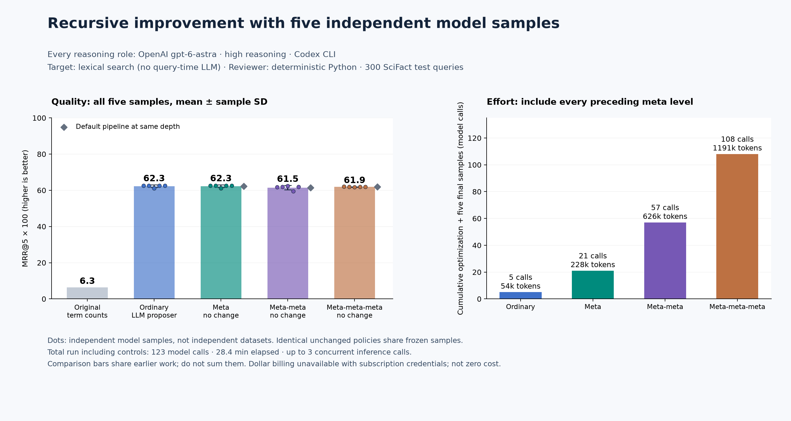

# libRSI

**Give your application an improvement loop—and improve the loop itself.**

libRSI turns proposed changes into measured experiments. An LLM suggests a better
search formula, prompt, or strategy; your workload measures it. libRSI compares
candidates and manages review, adoption, verification, and recovery. The next task
uses the accepted revision.

The same workflow can improve **the improver**: change its proposal instructions,
measure whether they produce better candidates, and use accepted instructions on
subsequent work. Repeat that idea on the process that writes those instructions
for higher-level recursive self-improvement.

**Python 3.11+ · Dependency-free core · Typed API · MIT**

## A real LLM-driven example

Search **5,183 scientific abstracts**, then improve the search and its improvers:

- **Ordinary:** the LLM writes two scoring formulas from training feedback.
- **Meta:** optimize the instructions given to that formula proposer.
- **Meta-meta:** optimize the instructions that rewrite the proposer's instructions.
- **Meta-meta-meta:** go one level higher if meta-meta finds no supported change.

Every higher-level instruction is propagated through actual model calls down to
search formulas. The experiment uses **five separate samples per policy**, with
matched two-formula budgets, separate generation/evaluation data, and the same
300 official SciFact test queries. All five outcomes are retained.

libRSI evaluates and governs the instruction changes. Inner formula trials use
a smaller scoring proxy; the [first example](docs/llm-search-benchmark.md) also
measures a complete native formula-adoption loop.

**Every reasoning role uses OpenAI `gpt-6-astra`, reasoning `high`, via Codex CLI.**
The search engine itself makes no LLM calls. Scoring uses relevance judgments;
review and libRSI's decisions use deterministic Python. libRSI has no built-in
model choice: your backend specifies it.



| Pipeline | Model driving proposals | MRR@5 × 100, mean ± SD | Meta policy adopted? |
| --- | --- | ---: | --- |
| Original term counts | None | 6.3 (fixed) | — |
| Ordinary LLM proposals | `gpt-6-astra`, high | 62.3 ± 0.69 | — |
| Meta | `gpt-6-astra`, high | 62.3 ± 0.69 | No |
| Meta-meta | `gpt-6-astra`, high | 61.5 ± 1.16 | No |
| Meta-meta-meta | `gpt-6-astra`, high | 61.9 ± 0.12 | No |

MRR@5 rewards placing relevant results near the top; 100 means every first result
is relevant. For context, the [first experiment's plain BM25-equivalent formula](docs/llm-search-benchmark.md)
scored **62.2** on these queries. The large gain over raw term counts does not
establish a new state of the art.

**No learned meta policy earned adoption in this run.** Rows without adoption use
the default pipeline at that depth; identical policies share frozen samples.
Meta-meta gained 1.29 points during development but lost 2.05 on separate shadow
queries, so libRSI rejected it. Extra rewriting did not establish a meta improvement.

The complete follow-up used **123 model turns**, **1,352,863 reported input/output
tokens**, and **28.4 minutes** with up to three concurrent inference
calls. Dollar billing is unavailable through subscription credentials, not zero.
This is one corpus with five model samples, not a general performance guarantee.
[Protocol, same-depth controls, rejected changes, costs and raw evidence](docs/recursive-search-benchmark.md).

## Run it

From a source checkout, install the benchmark dependencies and authenticate the
public Codex CLI with access to the model you name:

```bash
python -m pip install . numpy matplotlib
python examples/scifact_data.py --download ./scifact.zip
python examples/benchmark_recursive_search.py \
  --dataset ./scifact.zip --output ./recursive-run --model gpt-6-astra
python examples/plot_recursive_search.py \
  --report ./recursive-run/report.json --output ./recursive-run/improvement
```

Use a fresh output directory. This consumes model quota, with a hard ceiling of
160 turns and no automatic retries. For a smaller run, see the
[first LLM example](docs/llm-search-benchmark.md). The
[deterministic companion](docs/search-benchmark.md) needs no model access and
chooses among prewritten configurations and portfolios.

## Use it in your application

Supply an **adapter** that executes and measures a configuration, a **proposer**
using your chosen model, and a **reviewer** that checks experimental evidence.
Once those components, a store and a metric policy are supplied:

```python
from librsi import AdaptiveLoop, LearningCase

loop = AdaptiveLoop(
    store, adapter=adapter, proposer=proposer, proposer_id="my-model-proposer",
    reviewer=reviewer, reviewer_id="my-reviewer", policy=policy,
)
loop.run_task(LearningCase("task-1", task_input))
result = loop.learn(
    "round-1", shadow_cases=held_out_tasks,
    verification_cases=verification_tasks, activate=True,
)
```

For meta use, make the configuration the proposer's instructions, and make its
adapter measure the usefulness of generated candidates. The
[complete recursive example](examples/benchmark_recursive_search.py) runs native
root-policy experiments and checks that later tasks consume the saved decisions.

## Guides

- [Adaptive integration](docs/adaptive-operation.md) · [API](docs/api.md) · [Concurrent serving](docs/concurrent-adaptive-operation.md)
- [Model providers](docs/providers.md) · [External agents](docs/external-agent-protocol.md) · [HTTP/MCP](docs/service-protocol.md)
- [Consumer integration](docs/consumer-integration.md) · [Testing](docs/testing.md) · [Migration](docs/migration-0.2.md)

Your application owns metric quality, execution isolation and effects. libRSI owns
the experiment and decision records; proposals still have to earn adoption.

libRSI-owned material is [MIT licensed](LICENSE). [Separate upstream license boundaries](docs/license-decision.md).
