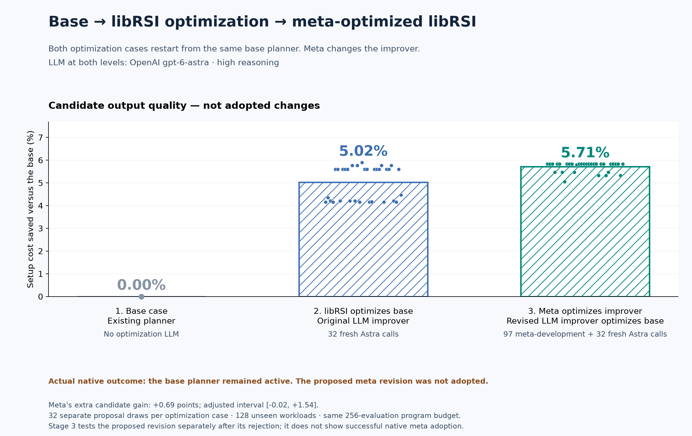

# libRSI

**Describe what should improve. Test competing ideas. Keep changes that earn adoption.**

libRSI supports **declarative, experiment-driven optimization**. You provide an
outcome and constraints; a connected model proposes a measurable interpretation,
baseline and competing experiments. Your application executes them. libRSI records
evidence and manages comparison, review, adoption, verification and recovery.

The same workflow can improve **the improver**: revise its instructions, measure
whether they produce better candidates, and use accepted instructions on later
work. Repeat at higher levels for recursive improvement.

**Python 3.11+ · Dependency-free core · Typed API · MIT**

## Base → LLM optimization → meta optimization

Start with **“Reduce changeover downtime while keeping planning inexpensive.”**
Astra translates this into setup-cost reduction, a 2% worthwhile-effect threshold,
and competing search strategies. It assembles programs for repeating 14-job
production schedules; the host enforces **256 cost evaluations per program**.

Compare three cases:

1. **Base:** run the existing planner without optimization.
2. **libRSI optimizes the base:** Astra proposes and libRSI evaluates changes to
   that planner, using the original improver.
3. **Meta optimization, then optimize the base:** Astra proposes changes to the
   improver itself. Test the revised improver on the **same starting planner**.
   This measures whether improving the improver produces a better final system.

Cases 2 and 3 both start from the base. Case 3 does not start from case 2's output.

**Every reasoning role uses OpenAI `gpt-6-astra`, high reasoning, via Codex CLI:**
goal interpretation, program proposals, meta revisions and subsequent proposals.
The planner, scoring and reviewer use **no model**. libRSI has no default model;
your backend specifies one.



| Comparison | Optimization model | Candidate cost saved vs base | Native adoption |
| --- | --- | ---: | ---: |
| 1. Base | None | 0% | Starting state |
| 2. libRSI optimization of base | `gpt-6-astra`, high | 5.02% | No |
| 3. Meta → libRSI optimization of base | `gpt-6-astra`, high at both levels | 5.71% | No |

Each optimization case has **32 proposal draws on 128 unseen synthetic workloads**.
The proposed meta improver adds **0.69 percentage points** over the original
improver, adjusted interval **−0.02 to +1.54**. That does not establish the
prespecified two-point worthwhile gain. Extra-budget controls are in the
[full results](docs/setup-sequence-benchmark.md).

**The requested end-to-end adoption chain did not succeed in this run.** The
recorded native passes kept the base planner and original improver. The 5.02% and
5.71% figures score generated candidates separately; the proposed meta revision
was tested despite its rejection. They must not be read as deployed libRSI gains.
We also found a facade limitation: ties count against proposals, and evidence
order can change early decisions.
[Diagnosis and controlled reproduction](docs/meta-diagnosis.md).

Total: **261 Astra calls · 3,560,773 reported input/output tokens · 35.0 minutes**.
Dollar billing is unavailable. Call budgets share samples; tokens and time are
not matched. [Full protocol, uncertainty, costs and replayable evidence](docs/setup-sequence-benchmark.md).
The earlier [scientific-search study](docs/recursive-search-benchmark.md) also
runs meta, meta-meta and meta-meta-meta; none of those revisions generalized.

## Run it

From a source checkout, authenticate Codex CLI with Astra access. The exact
reference solver requires a C++17 compiler.

```bash
python -m pip install . numpy matplotlib
python examples/benchmark_setup_sequence.py --output ./sequence-run --model gpt-6-astra
python examples/plot_setup_sequence_overview.py --report ./sequence-run/report.json --output ./sequence-run/overview
```

Use a fresh output directory: 300-call ceiling, no automatic retries.
[Smaller LLM example](docs/llm-search-benchmark.md) · [No-model companion](docs/search-benchmark.md).

## Connect your application

Supply a measuring adapter, model-backed proposer, reviewer, store and metric policy:

```python
from librsi import AdaptiveLoop, LearningCase

loop = AdaptiveLoop(
    store, adapter=adapter, proposer=proposer, proposer_id="my-model-proposer",
    reviewer=reviewer, reviewer_id="my-reviewer", policy=policy,
)
loop.run_task(LearningCase("task-1", task_input))
result = loop.learn(
    "round-1", shadow_cases=held_out_tasks,
    verification_cases=verification_tasks, activate=True,
)
```

The intent layer accepts a proposed evaluation contract; low-level `improve()`
requires completed operationalization and initial competing hypotheses. The
[goal interpreter](examples/sequence_intent.py) and
[complete runner](examples/benchmark_setup_sequence.py) connect those interfaces.
Your application supplies meaningful measurements, representative data and execution
isolation; installing libRSI alone does not supply a universal autonomous optimizer.

## Guides

- [Adaptive integration](docs/adaptive-operation.md) · [API](docs/api.md) · [Concurrent serving](docs/concurrent-adaptive-operation.md)
- [Model providers](docs/providers.md) · [External agents](docs/external-agent-protocol.md) · [HTTP/MCP](docs/service-protocol.md)
- [Consumer integration](docs/consumer-integration.md) · [Testing](docs/testing.md) · [Migration](docs/migration-0.2.md)

libRSI-owned material is [MIT licensed](LICENSE). [Separate upstream license boundaries](docs/license-decision.md).
