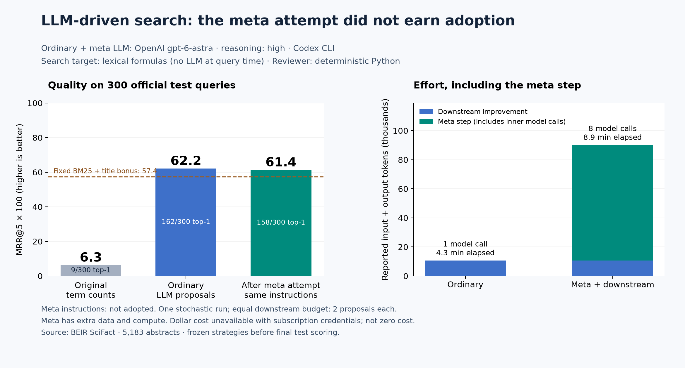

# First run: LLM-driven search improvement and meta improvement

The [five-sample recursive follow-up](recursive-search-benchmark.md) tests
stochastic variation and higher meta levels. This page retains the original run
and its evidence, including the unsuccessful meta attempt.

This experiment asks two questions: can an LLM propose a useful change to a search
engine, and can an LLM improve the instructions used to propose those changes?
The search engine itself makes **no LLM calls**. Model calls happen in the
improvement process and are counted below.

## What changes, and who changes it?

The initial ranker adds matching term counts (`tf`). The ordinary proposer receives
measured training performance and examples of retrieval successes and failures.
It writes two new arithmetic scoring expressions. These expressions may combine
term frequency, title frequency, inverse document frequency, and relative document
length. The expression interpreter accepts a small numeric grammar; it does not
execute arbitrary Python or expose filesystem/network access. There is no finite
inventory of candidate formulas.

libRSI runs the expressions against actual documents, compares measured MRR@5,
and applies its selection, shadow evaluation, review, adoption and verification
workflow. The reviewer is a deterministic callback checking native evaluation
disposition, not a second LLM or a human. A model's explanation is a hypothesis;
it is never used as a score or an approval.

The meta loop's configurable artifact is **the instruction string given to the
formula proposer**. Its adapter calls that proposer on small retrieval tasks,
measures the usefulness of the generated formulas, and supplies those results as
feedback. The meta LLM writes two replacement instruction strings. libRSI tests
them, and any accepted instruction is loaded from durable storage and used in a
fresh ordinary improvement pass. Both downstream passes start from `tf`, receive
the same development queries, and have the same two-formula budget.

This is two-level recursive application of the improvement workflow. It changes
the improver's instructions, not model weights, libRSI's code, or acceptance rules.

## Exact model roles

| Role | Model/provider used in this run | What it produces |
| --- | --- | --- |
| Ordinary formula proposer | OpenAI `gpt-6-astra`, reasoning `high`, authenticated Codex CLI | Two new scoring expressions |
| Meta instruction proposer | OpenAI `gpt-6-astra`, reasoning `high`, authenticated Codex CLI | Two replacement proposer instructions |
| Inner proposer during meta evaluation | OpenAI `gpt-6-astra`, reasoning `high`, authenticated Codex CLI | Two formulas for each instruction/task sample |
| Formula proposer after meta | OpenAI `gpt-6-astra`, reasoning `high`, authenticated Codex CLI | Two formulas using the active instruction from the meta store |
| Search engine and relevance scorer | No LLM; Python/NumPy plus SciFact judgments | Ranked document IDs and MRR@5 |
| Reviewer and adoption logic | No LLM; deterministic callback and libRSI | Review and verified active strategy |

The CLI version is `codex-cli 0.166.0`. The model identifier is the exact requested
service alias; the CLI does not return an immutable weights snapshot. These
results therefore identify the model and run date without claiming a pinned
model build. Token usage comes from each successful `turn.completed` event.
Credentials use the authenticated subscription; billed dollar cost is unavailable,
**not $0**. Authoring this benchmark with a coding assistant is separate from the
model calls recorded inside it.

libRSI has no implicit default LLM. Applications provide their reasoning backend.
This example uses a small public-CLI backend in
[`llm_search.py`](../examples/llm_search.py). It is separate from the library's
internal Codex adapter, which requires qualified private dependencies. For API
integrations, the public [OpenAI backend](providers.md) requires an explicit model
identifier in `OpenAIResponsesConfig(model=...)`.

## Results and effort

| System | Proposing LLM | Official test MRR@5 | Relevant first result |
| --- | --- | ---: | ---: |
| Original term counts | None | 0.0631 | 9/300 |
| Ordinary LLM improvement | `gpt-6-astra`, high | 0.6217 | 162/300 |
| After rejected meta attempt; original instructions | `gpt-6-astra`, high | 0.6139 | 158/300 |
| Fixed BM25 + title bonus control | None | 0.5741 | 151/300 |

**No meta revision was adopted.** Ordinary improvement and the post-meta rerun
both finished `verified`; the meta pass finished `no-supported-revision`. The
post-meta score is a fresh sample using unchanged instructions and is **not**
evidence of a meta benefit.

| Phase | LLM (all calls) | Calls | Input tokens | Output tokens | Query executions | Elapsed |
| --- | --- | ---: | ---: | ---: | ---: | ---: |
| Ordinary | `gpt-6-astra`, high | 1 | 10,322 | 397 | 1,260 | 255.7s |
| Meta attempt | `gpt-6-astra`, high | 7 | 74,578 | 4,909 | 3,500 | 310.4s |
| Downstream rerun | `gpt-6-astra`, high | 1 | 10,322 | 356 | 1,260 | 222.6s |

The complete experiment took **13.4 minutes** (209.4s Python
CPU), with **9 model turns**, **95,222 input tokens** and
**5,662 output tokens**. Adaptation used 6,020 query executions;
final reporting and the control used another 2,400, for 8,420 total.
All 3,147 reported reasoning output tokens and the zero cached-input
subcount are retained in the receipts. Billed dollar cost is **unavailable**.
Including the separately disclosed authentication preflight, total model usage
was **10 calls, 104,153 input tokens and 5,677 output tokens**.

The accepted formulas were:

```text
Ordinary: idf*tf/(tf+0.3+0.9*length)
Rerun:    idf*sqrt(idf)*(tf/(tf+0.5+0.5*sqrt(length))+0.35*title_tf/(title_tf+1))
```

Both were generated by `gpt-6-astra` during the measured run. The meta-proposed
instructions and all generated alternatives are retained in the
[model transcript](benchmarks/llm-search/model-transcripts.json.gz).



MRR@5 is the mean reciprocal rank of the first relevant result among the top five:
1 for rank one, 1/2 for rank two, and 0 if none is relevant. The chart displays
MRR × 100; it is not accuracy. Top-one counts are reported separately.

The token graph counts reported input plus output tokens. Cached input is already
included in input, and reasoning output is already included in output; neither
is added a second time. The raw report also retains those subcounts. Timings
include model waiting, retrieval, native bookkeeping, evidence writes and store
reopening on a shared host. They exclude dependency setup, software authoring and
plotting; CPU time covers the Python process, not remote inference or CLI children.
Model-call counts mean completed CLI model turns, not unobservable network retries.

One separate authentication preflight used the same model and reasoning setting:
8,931 input tokens, 15 output tokens, zero reported reasoning output tokens, and
one call. It only returned `{"ready":true}` and contributed no candidates or task
measurements. Its elapsed time was not instrumented. It is excluded from the
experiment chart but included here as setup overhead. No failed benchmark attempts
or repeated seeds are omitted.

The ordinary adopted expression, `idf*tf/(tf+0.3+0.9*length)`, is conventional
BM25 with `k1=1.2`, `b=0.75`, divided by the positive constant 2.2. This changes
no ranking in exact arithmetic. The LLM generated a useful known algorithm; this
is not a claim of discovering a new retrieval method. The separately measured
fixed control adds a title bonus of `2*idf*minimum(title_tf,1)` to BM25.

### What happened to the proposed meta changes?

Both generated instructions were actually used to generate formulas on the two
meta-training tasks. The formulas were selected on each task's 50 tuning queries,
then measured on its separate 50 scoring queries. All model calls below used
**OpenAI `gpt-6-astra`, reasoning `high`**.

| Proposer instructions (LLM: `gpt-6-astra`, high) | Task 1 scoring MRR@5 | Task 2 scoring MRR@5 | Mean lift over original | Outcome |
| --- | ---: | ---: | ---: | --- |
| Original | 0.7117 | 0.6557 | — | Retained |
| Model revision: controlled refinement + diverse alternative | 0.7007 | 0.6557 | −0.0055 | Rejected |
| Model revision: competing error explanations | 0.6917 | 0.6590 | −0.0083 | Retired at experiment budget |

These are **meta-training task scoring halves, not official test results**.
No revision advanced to shadow or verification. Only the 200 meta-training
queries were consumed; the 400 reserved meta shadow/verification queries remained
unused. The resulting native disposition was `no-supported-revision`, and the
post-meta pass used the original instructions. A different score in that pass
reflects a new model sample, not an accepted meta improvement.

## Data and protocol

The pinned [BEIR SciFact archive](https://github.com/beir-cellar/beir/wiki/Datasets-available)
contains 5,183 scientific abstracts, 809 training queries and 300 official test
queries with relevance judgments. It originates from
[SciFact](https://github.com/allenai/scifact). This evaluates retrieval of annotated
evidence, not whether a scientific claim is true. The complete corpus is downloaded
by the runner. Diagnostic query/title excerpts remain in prompt evidence under
upstream terms; this repository does not relicense the dataset.

The [committed split manifest](../examples/data/scifact-split.json), dataset hash,
and shuffle seed `20261111` are shared with the supplementary deterministic
experiment. There is no query overlap between these partitions:

| Partition | Queries | Purpose |
| --- | ---: | --- |
| Ordinary training / shadow / verification | 60 / 60 / 60 | Both downstream passes; four 15-query batches per phase |
| Meta training / shadow / verification | 200 / 200 / 200 | Two tasks per phase, each with 50 tuning and 50 scoring queries |
| Unused training | 29 | Unused |
| Official test | 300 | Final reporting only, after strategies are frozen |

The ordinary LLM sees the baseline score and eight diagnostic examples chosen
deterministically from its training queries: six worst and two best. Diagnostics
include query text, relevant document titles and retrieved titles. It cannot see
shadow, verification or test judgments. The meta LLM sees only meta-training
measurements and generated formulas. The inner LLM for each meta task sees that
task's **tuning** diagnostics; it cannot see the task's scoring queries or labels.
Neither proposer is told the earlier deterministic test scores.

For each instruction/task pair, the meta adapter requests two formulas, picks
the best on tuning queries if it improves over `tf` by at least 0.01, and measures
it on separate scoring queries. The meta metric is its paired MRR lift over the
original instruction on that same task. This is a proposal-utility proxy, not a
complete native adoption loop inside every meta evaluation. The final transfer
comparison does use the native ordinary loop.

One genuine model sample is frozen per instruction/tuning-task pair and reused
when libRSI replays measurements. The cache key excludes scoring data; rankings
are recomputed, not cached. This makes replay stable and bounds expense. It does
not measure the distribution of model outputs across repeated samples.

Both levels use two candidates, minimum effect 0.01, libRSI's native evaluation
and the deterministic review callback. The meta level has two task batches per
phase; the ordinary level has four. Before final scoring, all three active
strategies and native result roots are saved. Final ordinary tasks reopen their
stores, and the runner checks that their producing strategy roots match the
frozen revisions. A fixed BM25 expression with a title bonus is scored as an
additional conventional control; it does not influence adoption.

The protocol file is written before model access. The stopping rule is one
ordinary pass, one meta pass, and one downstream pass using the resulting active
instruction. There are at most 24 model turns, a 180-second timeout per turn,
and no automatic proposal retries, model switching, or test-driven reruns.
Model tools, web access, plugins and project instruction discovery are disabled
for these inference turns; a detected tool event fails the run. See the
[Codex configuration reference](https://learn.chatgpt.com/docs/config-file/config-reference)
for the CLI settings. Authentication remains in the user's existing credential store.

## Interpretation and limits

The initial term-count ranker is deliberately simple; a strong conventional
retriever is the more meaningful quality control. A gain over `tf` alone is not
evidence of beating retrieval research or of libRSI outperforming direct tuning.
The meta arm also receives additional data and compute. Its downstream budget
matches ordinary use, but total investment does not.

This is one stochastic run on one corpus with two meta tasks per phase. Results
do not establish average model performance, repeatability across model samples,
or cross-domain benefits. Differences between downstream passes may also reflect
sampling variation; this single run cannot isolate the causal effect of the
instruction change. A rejected meta change or a lower final score remains
in the report. The public test set was previously used for the deterministic
example and may occur in model training; it is held out from this run's proposal
and selection process, not claimed to be globally novel data.

## Reproduce

Install the public Codex CLI and authenticate it with access to the explicit model
you intend to measure. Model use consumes your account's quota or spend.

```bash
python -m pip install . numpy matplotlib
python examples/scifact_data.py --download ./scifact.zip
python examples/benchmark_llm_search.py \
  --dataset ./scifact.zip --output ./llm-search-run --model gpt-6-astra
python examples/plot_llm_search.py \
  --report ./llm-search-run/report.json --output ./llm-search-run/improvement
```

Use a fresh directory; the runner refuses to overwrite evidence. Failed or
uncertain calls retain receipts and stop. Keep that directory for diagnosis;
do not resume by silently regenerating paid samples. Different accessible models
can be passed explicitly, but their results must be reported under their own IDs.

The output includes the protocol, exact application prompts and responses, per-call
token receipts, durable native stores, native evidence, frozen strategies and
per-query test rankings. The CLI adds its own runtime context; the transcript is
not a capture of the complete wire request. Token counts include that context.
Published evidence is under [`benchmarks/llm-search/`](benchmarks/llm-search/).
The executed source snapshot is retained alongside source hashes and the environment
receipt. The shared helper later gained typing fixes, null-snapshot guards and
recursive sampling support. The archive preserves the exact code used in this run;
its recorded formulas, model requests, measurements and decisions are unchanged. The previous
[deterministic experiment](search-benchmark.md) remains a supplementary example
of choosing among predefined configurations, with zero inference calls.
