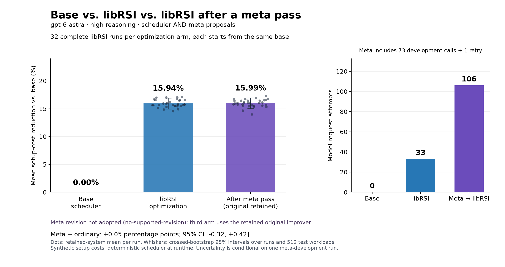
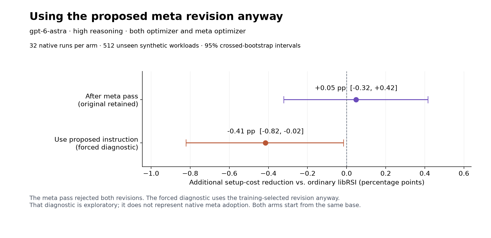
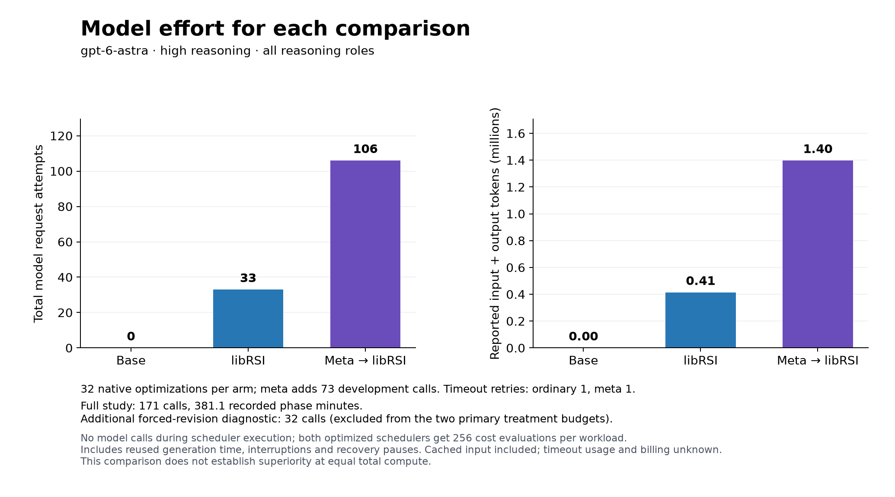

# Base, libRSI optimization, and meta optimization

This experiment evaluates the **systems retained by completed native libRSI
workflows**. Candidate quality is not substituted for an adopted result.

The three primary cases are:

1. Run the original scheduler.
2. Use the original LLM improver to optimize that scheduler through libRSI.
3. Use an LLM to revise the improver through libRSI, reopen the retained improver,
   then use it to optimize a fresh copy of the **same original scheduler**.

Case 3 never starts from case 2's optimized scheduler. If the outer meta pass
rejects its proposed revision, case 3 uses the retained original improver.

## Measured results

The completed experiment contains **168 native scheduler-optimization runs and
one native meta pass**. All 168 scheduler changes were adopted, verified and
reopened successfully. The meta pass rejected both proposed instruction
revisions and retained the original improver. Every optimization and meta proposal
used **OpenAI `gpt-6-astra`, high reasoning**; scoring, review and scheduler
execution used no LLM.

The primary panel has **512 unseen workloads** and **32 independent optimization
runs per arm**. Cost reductions are measured against the same original scheduler.

| Case | Model driving optimization | Mean cost reduction | 95% interval for mean | Model request attempts |
| --- | --- | ---: | ---: | ---: |
| Original base | None | 0% | Reference | 0 |
| libRSI optimizes base | `gpt-6-astra`, high | 15.94% | [14.94%, 16.93%] | 33 |
| After meta pass, original improver retained | `gpt-6-astra`, high at both levels | 15.99% | [15.01%, 16.97%] | 106 |



After-meta minus ordinary is **+0.048 percentage points**, with a 95% interval of
**[−0.322, +0.415]**. This is not evidence of a learned meta improvement: both arms
used the same retained instruction and differ in their independent model samples.
The interval for their difference is narrower than the individual mean intervals
because both arms are evaluated on the same workloads.

The original 128-workload panel is retained as a sensitivity check: ordinary
libRSI achieved **15.10%**, versus **14.99%** after meta, a difference of
**−0.105 pp [−0.579, +0.375]** (95% interval; `gpt-6-astra`, high at both levels).
Neither panel establishes an additional meta benefit. The 512-workload expansion
was registered before meta and final-system freezes, not selected after seeing
these outcomes.

### Using a rejected revision anyway

The registered diagnostic used revision 1, selected by its higher training mean,
for 32 new native optimizations. All 32 scheduler changes passed the inner gates.
They achieved **15.52%** mean cost reduction on the same 512 workloads, versus
**15.94%** for the ordinary improver: **−0.415 pp [−0.822, −0.016]**, an exploratory
95% interval. **`gpt-6-astra`, high**, generated both this instruction and its
scheduler proposals. This is an actual test of the proposed instruction, but
does not represent an accepted native meta update.



The additional transfer check evaluated all 24 retained development systems from
each instruction on those same 512 unseen workloads. It made no new model calls.

| Development pool | Proposal and meta model | Mean cost reduction | Difference from original | Exploratory 97.5% interval |
| --- | --- | ---: | ---: | ---: |
| Original instruction | `gpt-6-astra`, high | 16.55% | Reference | — |
| Revision 1 | `gpt-6-astra`, high at both levels | 15.51% | −1.04 pp | [−1.67, −0.43] |
| Revision 2 | `gpt-6-astra`, high at both levels | 16.00% | −0.55 pp | [−1.05, −0.03] |

These two intervals account for two exploratory comparisons. These development
pools used different native training cases and sequential request batches, so
their means must not be pooled with or substituted for the primary final arms.
They independently support the narrower conclusion that neither proposed
instruction improved this benchmark in this meta round.

### Why the meta pass did not help

Both revisions already lost on the training comparison used by the outer pass.
The stage means below use eight independent model draws per instruction per
stage; they are development evidence, not final-test results.

| Outer scoring stage | Proposal and meta model | Original instruction | Revision 1 | Revision 2 |
| --- | --- | ---: | ---: | ---: |
| Training | `gpt-6-astra`, high | 16.13% | 15.76% | 15.71% |
| Shadow | `gpt-6-astra`, high | 16.81% | 16.70% | 17.54% |
| Verification | `gpt-6-astra`, high | 16.99% | 15.81% | 17.06% |

Revision 2's positive shadow mean did not persist in the unseen transfer panel.
The forced revision-1 experiment also lost on fresh optimization draws. Together
with successful adoption of every inner scheduler change, these results indicate
that the current meta rejection was supported by candidate quality, rather than
the earlier library gate defect silently blocking useful scheduler changes.

The task still had headroom: the unrestricted exact solver could reduce costs
by **33.26%** on average, compared with ordinary libRSI's **15.94%**. That solver
is an audit reference, not a competitor limited to 256 evaluations; its gap does
not prove that the current search primitives and budget can recover all of it.

One plausible explanation is that the revised instructions overconstrained the
search. The forced revision produced 24 distinct program JSONs across 32 runs,
averaging 5.81 stages, compared with 32 distinct JSONs and 3.28 stages for the
original instruction. Its run-mean standard deviation fell from 0.68 to 0.20 pp,
but its mean got worse. This describes reduced variation, not demonstrated causal
evidence about which instruction clause hurt performance. A single meta round
with two proposed instructions cannot establish a general limit on meta learning.

### Effort and retained evidence

| Phase | Model | Completed calls | Timeouts | Known input + output tokens |
| --- | --- | ---: | ---: | ---: |
| Ordinary final arm | `gpt-6-astra`, high | 32 | 1 | 413,659 |
| Meta development | `gpt-6-astra`, high at both levels | 73 | 0 | 983,617 |
| After-meta final arm | `gpt-6-astra`, high | 32 | 1 | 413,758 |
| Forced-revision diagnostic | `gpt-6-astra`, high | 32 | 0 | 434,913 |
| Full measured study | `gpt-6-astra`, high | 169 | 2 | 2,245,947 |
| Earlier setup attempts and transport probes, outside study | `gpt-6-astra`, high | 7 | 6 | 86,656 |



The main experiment recorded **6.35 hours** of phase wall time, including reused
proposal-generation time, interruptions and recovery pauses. This is not model
latency or total engineering effort; offline audit, confirmation, plotting and
coding work are outside that timing. Reported input includes **941,440 cached
tokens**; reasoning-output tokens are already included in output and are not
added again. Timeout usage and dollar billing are unknown.

The 24 proposals recovered from an earlier worker-handoff failure are counted
once. Sixteen completed native runs survived a later interruption and were
checked against their durable stores. Subsequent transport recoveries rechecked
all 72 development outcomes. No outcome-based sample substitution occurred.

The [run-level CSV](benchmarks/native-sequence/run-scores.csv) contains one base
reference and 96 final outcomes, with model labels and native adoption status.
[Full evidence](benchmarks/native-sequence/) includes model prompts and outputs,
receipts, compressed native records, source snapshots, registered amendments,
the original 128-workload result, the 512-workload result, and transfer diagnostics.
The offline audit replayed every development score and original test score;
confirmation reproduced all original 128 scores exactly before adding workloads.

## Model and task

**OpenAI `gpt-6-astra`, high reasoning, via Codex CLI** generates both scheduler
programs and proposed improver instructions. The same model and reasoning setting
are used before and after the meta pass. The native comparison, reviewer and
scheduler execution are deterministic and use no model. libRSI does not select a
default model; the example backend explicitly supplies it. The model identifier is
an alias, not an immutable weight snapshot.

The task is to reduce setup costs in a repeating 14-job production cycle. Costs
are synthetic directed matrices, evenly divided among independent, clustered,
noisy spatial and sparse-cheap-transition families. Each job appears exactly once
and the return transition counts. Cost reduction is `1 - cost / original_cost`,
averaged over workloads and optimization runs.

The original scheduler follows nearest neighbors starting at job 0. This leaves
more room for improvement than the earlier study's best-of-all-starts baseline.
Astra assembles JSON programs using swap, relocation and reversal, different
sampling strategies, acceptance rules and restarts. Each proposed program gets
exactly **256 cost evaluations per workload** and retains its best valid cycle.
The host interprets these primitives; it never executes model-generated source.
An exact dynamic-programming solver supplies an audit reference, not model input.

These are improvements in **synthetic setup cost**, not measured factory
throughput or claims about production scheduling performance.

## Registered comparison

Each inner run begins from the original scheduler, obtains two Astra proposals,
and executes `AdaptiveLoop.learn(..., activate=True)` with native investigation,
comparison, forward-shadow evaluation, review, adoption and verification. It
reopens the durable store and checks the active strategy. Rejected, invalid or
rolled-back proposals leave the original system in the reported outcome.

The two proposals come from one model call. The 32 final runs per arm are
independent repetitions to measure variability, not 32 successive improvement
steps on one scheduler. Meta development is an additional upfront expense.

Training, shadow and verification each contain 32 distinct workloads, grouped
into two native cases of 16. Each group is balanced across the four families.
The inner minimum effect is **0.02**: two percentage points of setup-cost
reduction. These batches make the native workflow affordable; the final analysis
uses individual workloads and independent model draws, not just two case means.

The outer meta pass optimizes an instruction string. Its adapter runs the entire
inner libRSI workflow and measures the retained scheduler. Each outer stage uses
eight independent model draws on distinct evaluation workloads, grouped into two
native cases of four draws. The outer minimum effect is **0.005**: half a
percentage point of additional retained-system cost reduction.

Astra sees only the first eight original-improver development runs when writing
two proposed instruction revisions. Both revisions are evaluated through 24 new
complete native optimizations. The outer pass chooses whether to adopt a revision
using separate training, shadow and verification draws. That is **73 development
calls**: 24 original-improver draws, one instruction-revision call, and 48
revised-improver draws. Neither model nor evaluator receives the final test set
as proposal feedback.

The meta prompt requested instructions no longer than 2,400 characters; the
existing host validator permits up to 3,000. Astra returned 2,601- and
2,841-character instructions. Both passed the frozen host validator and were
used unchanged. This prompt-length shortfall is retained in the transcripts;
neither response was shortened or regenerated.

After the active improver is frozen and reopened, each primary optimization arm
receives **32 independent model draws** on fresh inner training/shadow/verification
partitions. Both arms start from the same original scheduler. All native outcomes
are frozen before evaluation on unseen workloads. The runner initially reserved
128 workloads. Before the meta policy or any final systems were frozen, we
registered an expansion to **512 workloads** (the original 128 plus 384 new
workloads), without adding model calls or optimization runs. The original
128-workload result is also retained. The published comparison uses this
prospectively expanded panel.

If the meta revision is rejected, a prespecified diagnostic additionally runs 32
native optimizations using the proposed instruction with the better outer-training
mean. This is a **forced-instruction diagnostic**, not native meta adoption. It
cannot replace case 3 in the primary comparison.

The primary contrast is after-meta minus ordinary. Its 95% interval uses 10,000
crossed-bootstrap resamples: independent model-draw indices in each arm and
shared workload indices resampled within family. It is conditional on one meta
training run; it does not estimate variability across repeated meta training.
The protocol does not stop early after a favorable outcome or add samples until
significance. There is no equal-total-compute control in this study.

Effort totals cover this experiment's recorded provider calls. Coding and review
work are not metered in those totals, and earlier experiments retain their own
cost ledgers. Dollar billing is unavailable; reported input tokens include cached
input. Setup failures are itemized separately from the main comparison.

### Transport recovery deviation

Final-sampling request 128 (`after_meta-21`) timed out after 600 seconds, emitting
only session-start events and no response or usage. The runner stopped. Before
any final systems or test scores existed, a recorded amendment allowed one manual
retry with the identical prompt, schema, instructions, model (`gpt-6-astra`, high)
and timeout. That retry completed in 49.2 seconds. The original failed receipt
remains unchanged; no completed sample was discarded or replaced.

The last outstanding request, 169 (`ordinary-12`), subsequently had the same
failure: session-start events only, then a 600-second timeout. A second recorded
amendment allowed one identical-request retry before any final systems or test
evaluation. Both failed originals are retained.

This exceeds the original 169-attempt ceiling by two: **171 attempts, 169 completed
calls, two timeouts with unknown token usage**. Each primary optimization arm
includes one extra attempt. Token totals are known usage, not a complete bill.
The recovery code requires an explicit recorded mapping and never retries
automatically.

## Additional transfer diagnostic

After meta development, before any final systems or test scores were frozen, we
recorded an exploratory check of **all three development pools**: 24 retained
systems from the original improver and 24 from each proposed instruction. These
existing programs are evaluated on the same 512 unseen workloads. This adds no
model calls or native optimization runs and does not replace the primary final
comparison or its training-selected forced-instruction diagnostic.

The motivation was mixed development evidence: both revisions lost on training,
while the second showed positive shadow and verification means. Evaluating every
development pool avoids reporting only the instruction selected by training.
Two crossed-bootstrap comparisons against the original use 97.5% intervals each
(Bonferroni for two exploratory comparisons). They remain conditional on one meta
development round. These programs used earlier native training cases and
sequential generation batches; the primary final arms use fresh native cases and
interleaved requests. All reasoning in both analyses uses **`gpt-6-astra`, high**.

## Library correction

This run uses facade evidence mapping version 3. Exact ties have zero weight;
nonzero evidence is weighted by effect magnitude and the total confidence
movement is bounded. Older persisted passes retain their original behavior.
The canonical policies and subsequent acceptance gates are unchanged.
[Full diagnosis and regression details](meta-diagnosis.md#follow-up-versioned-facade-correction).

## Reproduction

From this source checkout, with an authenticated Codex CLI that can access Astra:

```bash
python -m pip install . numpy matplotlib
python examples/run_native_sequence_study.py --output ./native-sequence-run
```

The wrapper registers the 512-workload confirmation before meta development,
runs the native experiment, audits its evidence and creates both graphs. The
individual runner, auditor, confirmation evaluator and plotter are also available
in `examples/`.

A C++17 compiler is required for the exact reference solver. Use a fresh output
directory. The runner bounds model calls to 169, uses two concurrent requests,
and allows 600 seconds per request without automatic retries. Transport failures
retain receipts and stop the run; malformed model outputs consume their slots.
Repeated model requests need not reproduce identical proposals. The offline audit
replays retained-system scores from the recorded proposals and configurations.

If the host interrupts a worker, `python examples/resume_native_sequence.py
--source ./native-sequence-run/raw` validates completed results against their
durable stores and resumes pending native passes with the original samples.
It verifies the original runtime and experiment source hashes and counts saved
model responses once. An unfinished provider request stops recovery for diagnosis.
After recovery, run the auditor, confirmation evaluator and plotter against the
completed raw output, using fresh directories for their artifacts:

```bash
python examples/audit_native_sequence.py --source ./native-sequence-run/raw --output ./native-sequence-run/audit
python examples/extend_native_confirmation.py --source ./native-sequence-run/raw --output ./native-sequence-run/confirmation
python examples/plot_native_sequence.py --report ./native-sequence-run/confirmation/confirmed-report.json.gz --receipts ./native-sequence-run/raw/receipts.json --output ./native-sequence-run/plots
```

The earlier [candidate study](setup-sequence-benchmark.md) and
[recursive scientific-search study](recursive-search-benchmark.md) remain
available with their original evidence. Their results are separate experiments.
