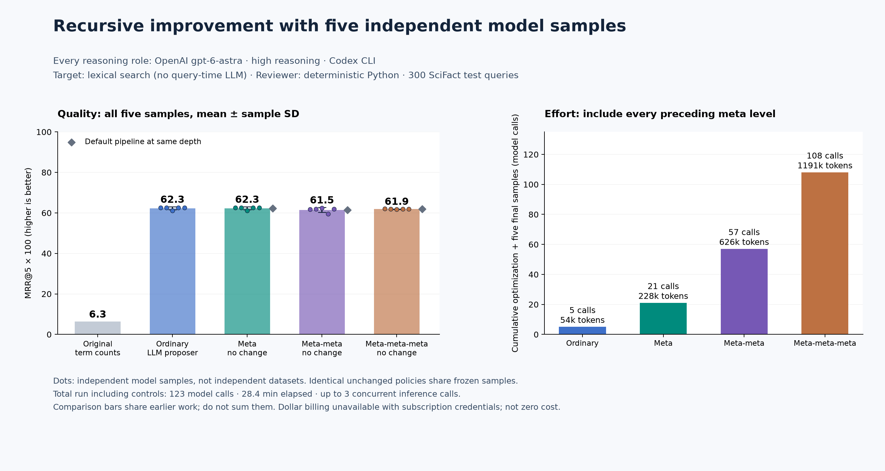

# Repeated LLM trials and deeper recursive improvement

The [first LLM experiment](llm-search-benchmark.md) improved retrieval but found no
supported meta revision. This follow-up increases the sample count to five and
tests changes higher in the proposal process. Every proposal is driven by
**OpenAI `gpt-6-astra`, reasoning `high`, through Codex CLI**. Search and review
remain deterministic; there is no query-time LLM call.

## What each level changes

| Experiment | Artifact libRSI tries to improve | How a trial reaches the search engine | Model for every arrow |
| --- | --- | --- | --- |
| Ordinary use | Search scoring formula | Proposer instructions → two formulas | `gpt-6-astra`, high |
| Meta | Instructions given to the formula proposer | Revised proposer instructions → two formulas | `gpt-6-astra`, high |
| Meta-meta | Instructions used to revise the formula proposer | Revised meta instructions → new proposer instructions → two formulas | `gpt-6-astra`, high |
| Meta-meta-meta, if needed | Instructions used to revise the meta proposer | Revised meta-meta instructions → new meta instructions → new proposer instructions → two formulas | `gpt-6-astra`, high |

The same model serves every reasoning role; these are changes to instructions,
not model weights or different model sizes. Each intermediate call emits one
child instruction. That exact text becomes the instructions in the next call.
The final call proposes two expressions in the numeric grammar from the first
experiment. Training measurements choose between the expressions and the `tf`
baseline. The full chain, not an LLM's opinion of it, is then scored.

libRSI runs a native `AdaptiveLoop` for each optimization level, with two proposed
root instructions, five sample cases, minimum effect 0.01, deterministic review,
shadow evaluation and verification. It can reject a change. The inner cascades
are a proposal-utility proxy; they do not each run another complete native
adoption workflow. This keeps the recursive experiment bounded.

## Results

| Pipeline | Model driving proposals | MRR@5 × 100, mean ± SD | Meta policy adopted? |
| --- | --- | ---: | --- |
| Original term counts | None | 6.3 (fixed) | — |
| Ordinary LLM proposals | `gpt-6-astra`, high | 62.3 ± 0.69 | — |
| Meta | `gpt-6-astra`, high | 62.3 ± 0.69 | No |
| Meta-meta | `gpt-6-astra`, high | 61.5 ± 1.16 | No |
| Meta-meta-meta | `gpt-6-astra`, high | 61.9 ± 0.12 | No |

**No learned meta policy earned adoption in this run.** Rows without adoption use the default pipeline at that depth. Changes from extra rewriting are not claimed as learned meta improvements. Meta-meta gained 1.29 points during development but lost 2.05 on separate shadow queries, so libRSI rejected it.

| Root optimization | Model | Native disposition | Model turns | Query executions | Wall seconds |
| --- | --- | --- | ---: | ---: | ---: |
| Meta | `gpt-6-astra`, high | `no-supported-revision` | 16 | 10,100 | 269.9 |
| Meta-meta | `gpt-6-astra`, high | `governance-rejected` | 31 | 16,100 | 489.7 |
| Meta-meta-meta | `gpt-6-astra`, high | `no-useful-improvement` | 46 | 10,100 | 523.8 |

Final sample distributions (all calls: **`gpt-6-astra`, high**):

| Pipeline | Five test MRR@5 values | Mean | Sample SD |
| --- | --- | ---: | ---: |
| Meta | 0.6260, 0.6264, 0.6108, 0.6260, 0.6264 | 0.6231 | 0.0069 |
| Meta-meta | 0.6183, 0.6198, 0.6236, 0.5946, 0.6192 | 0.6151 | 0.0116 |
| meta meta default | 0.6183, 0.6198, 0.6236, 0.5946, 0.6192 | 0.6151 | 0.0116 |
| Meta-meta-meta | 0.6207, 0.6185, 0.6174, 0.6185, 0.6187 | 0.6187 | 0.0012 |
| meta meta meta default | 0.6207, 0.6185, 0.6174, 0.6185, 0.6187 | 0.6187 | 0.0012 |
| Ordinary LLM proposals | 0.6260, 0.6264, 0.6108, 0.6260, 0.6264 | 0.6231 | 0.0069 |

Total: **123 model turns**, **1,310,397 input tokens**, **42,466 output tokens**, **28.4 minutes** elapsed and **259.1s** Python CPU. Root optimization used 93 calls; final sampling used 30. There were 57,360 ranked-query executions including repeated checks and final reporting. Cached-input and reasoning-output subcounts are retained in the report; billed dollars are unavailable.

The earlier single-sample experiment separately used 9 model turns and 100,884 input/output tokens over 13.4 minutes. Its authentication preflight used one additional turn and 8,946 tokens. These are retained setup/earlier-study costs, not included in the follow-up totals.

Development scoring during each root optimization (100 queries; all models **`gpt-6-astra`, high**):

| Level | Policy | Mean MRR@5 | Sample SD | Lift over that level's default |
| --- | --- | ---: | ---: | ---: |
| Meta | Default | 0.6598 | 0.0047 | +0.0000 |
| Meta | Candidate 1 | 0.6527 | 0.0000 | -0.0072 |
| Meta | Candidate 2 | 0.6490 | 0.0000 | -0.0108 |
| Meta-meta | Default | 0.6550 | 0.0032 | +0.0000 |
| Meta-meta | Candidate 1 | 0.6657 | 0.0000 | +0.0107 |
| Meta-meta | Candidate 2 | 0.6678 | 0.0000 | +0.0129 |
| Meta-meta-meta | Default | 0.6607 | 0.0078 | +0.0000 |
| Meta-meta-meta | Candidate 1 | 0.6678 | 0.0000 | +0.0071 |
| Meta-meta-meta | Candidate 2 | 0.6728 | 0.0000 | +0.0121 |


The meta-meta result illustrates why adoption is a separate step. Its selected
instruction improved mean development MRR by **1.29 points**, but the forward
shadow experiment on separate queries measured **−2.05 points** across five
samples. The native conservative effect interval was **[−2.23, −1.87] points**;
the required improvement was +1 point. libRSI returned `governance-rejected` and
kept the prior instruction. These are development/shadow measurements, not the
official final-test scores.

At meta-meta-meta, the best candidate's mean development gain was **1.21 points**,
but its native uncertainty bounds were **[0.86, 1.56] points** with five samples.
The conservative bound missed the required +1 point, so the result was
`no-useful-improvement`. This is a case where sampling variation affects the
decision; a positive sample mean alone was insufficient. These are the library's
reported `student-standard-error` bounds, not a claimed 95% confidence interval.



Each point is one independent model-generated cascade, selected using training
data and evaluated on all 300 official SciFact test queries. The error bars show
one **sample standard deviation across the five model samples**, not uncertainty
over 1,500 independent questions. The same 300 queries are reused in each sample.
Do not interpret five samples as a large-sample significance study.

The default pipeline at each depth is a control. It performs the same number of
intermediate rewrites, using the original instruction at that depth. Comparing
an optimized pipeline with this control helps distinguish extra inference from
an adopted improvement to the instruction that directs it. When no policy change
is adopted, the active and default configurations are identical and share the
same five frozen final samples. That equality is bookkeeping, not evidence that
independent stochastic runs would be identical.

## Protocol, decided before this run

- Five independent model samples per policy; at most three concurrent inference
  calls. Native store writes and scoring remain serial.
- Each root optimization proposes two instruction candidates. Each intermediate
  rewrite emits one instruction; each final proposer emits two formulas.
- Run meta and meta-meta. Run meta-meta-meta only if meta-meta does not adopt a
  supported revision. No extra levels, automatic retries, model switching, or
  selecting a stopping point from final test results.
- At most 160 model turns, each with a 180-second timeout. The call counter reserves
  capacity before provider access, including concurrent calls. Failure retains
  partial evidence and stops the run.
- Use the exact requested model alias `gpt-6-astra`, reasoning `high`, and record
  CLI version, actual token usage and elapsed work. Subscription billing does not
  expose dollar cost; unavailable is not zero. The provider does not expose an
  immutable weights snapshot through this CLI.

The dataset, checksum and [query split manifest](../examples/data/scifact-split.json)
are unchanged from the first experiment. The corpus contains 5,183 abstracts.
All partitions below are disjoint by query ID:

| Data | Queries | Used for |
| --- | ---: | --- |
| First half of `meta_train` | 100 | Model diagnostics and formula selection during root optimization |
| Second half of `meta_train` | 100 | Root training measurements, separate from formula generation/selection |
| `meta_shadow` | 200 | Native shadow evaluation if a candidate advances |
| `meta_verification` | 200 | Native verification if a candidate advances |
| `ordinary_train` | 60 | Fresh final-workload diagnostics and formula selection |
| Official `test` | 300 | Final reporting after every final cascade is frozen |

At each optimization depth, five complete chains are generated per root policy
using only the fixed 100-query generation partition. These actual samples are
frozen and reused when libRSI measures the policy on training-scoring, shadow and
verification queries. Rankings are recomputed for each measurement. The feedback
payload sent to child generators contains only generation-partition diagnostics.
The outer root proposer receives native training measurements and example chains;
its learned instructions can therefore reflect those development results. Official
test queries and judgments are absent from all generation and selection inputs.

Higher levels receive the saved active lower-level instructions, along with the
earlier levels' training summaries and adoption outcomes. Development partitions
are reused across levels, so this is an adaptive development process. It is not
a claim that each level has an entirely untouched validation set.

After root optimization, the runner reopens each native store and copies its
actual active instruction into the final workload. It generates **five fresh
cascades** using only the separate 60-query ordinary training partition. Both
active and same-depth default pipelines are prepared. Only then does it write
`frozen-final-cascades.json`, disable further sample generation, and score the
official test queries. Native `run_task()` observations verify that each audit
used the frozen configuration; query-level results are retained for every sample.

The official test set was already reported in earlier experiments. It remains
absent from this run's model prompts and all selection inputs, but it is not
claimed as globally unseen data. The follow-up protocol responds to the failed
meta-development experiment, not to choosing a favorable test-score stopping point.

## Effort and interpretation

The total report counts every successful model turn in root optimization,
intermediate rewrites, formula generation, and final sampling. Per-call receipts
also retain token subcounts and elapsed time. Calls that share a frozen sample
are counted once in the total. Cached input tokens are not added again to input
tokens; reasoning output is not added again to output tokens.

Per-pipeline effort in the graph includes cumulative optimization through that
level plus the calls needed for its five final cascades. Shared samples and earlier
levels can therefore appear in more than one comparison bar; summing bars does
not give the total experiment cost. The total report is the authoritative ledger.
Higher levels have more inference work even with the same two-formula downstream
budget. Wall time includes native bookkeeping and up to three concurrent model
calls, so it should not be compared as a serial model-latency benchmark.

This is one dataset and five draws per policy. A useful improvement would need
replication on other workloads and more model samples. Rejected changes and
negative results remain visible. A better score from a default deeper cascade
is not evidence that libRSI adopted a better root instruction.

## Reproduce

Use the authenticated public Codex CLI and an explicit model with available quota.
All dependencies and native interfaces are the same as the first example.

```bash
python -m pip install . numpy matplotlib
python examples/scifact_data.py --download ./scifact.zip
python examples/benchmark_recursive_search.py \
  --dataset ./scifact.zip --output ./recursive-run --model gpt-6-astra
python examples/plot_recursive_search.py \
  --report ./recursive-run/report.json --output ./recursive-run/improvement
```

Use a fresh directory. The output retains the pre-run protocol and source snapshot,
all generated/selected cascades, application prompts and responses, model receipts,
native evidence, frozen final strategies, and every test ranking. The CLI adds its
own runtime context; recorded application prompts are not a complete wire capture.
Published records live under [`benchmarks/recursive-search/`](benchmarks/recursive-search/).
The recorded Git revision is the parent checkout. The source hashes and
`executed-sources.json.gz` retain the exact executed files, including the benchmark
code that was uncommitted when the run began.
The earlier [single-sample LLM](llm-search-benchmark.md) and
[deterministic](search-benchmark.md) experiments remain available with their original
evidence and separate costs.
