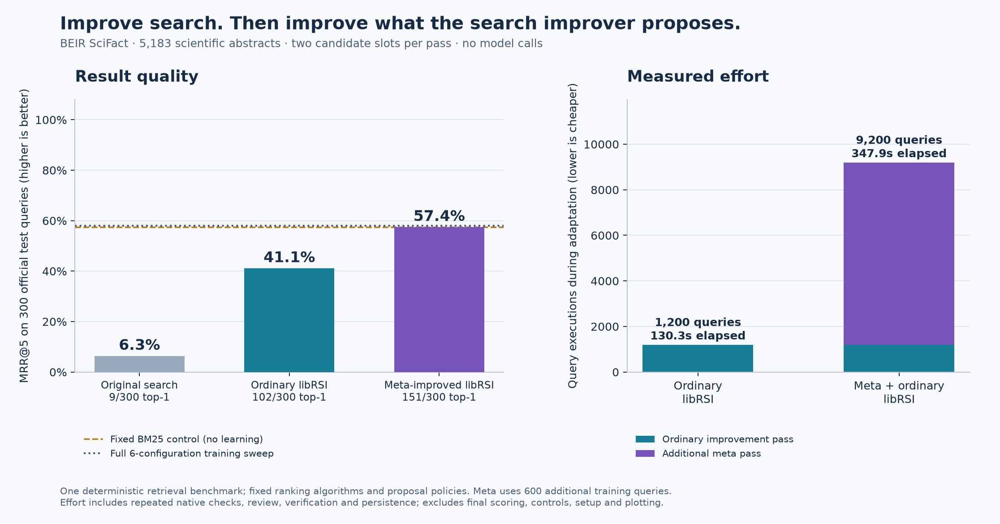

# Search improvement and meta-improvement

This benchmark asks a concrete question: **does changing an improver's proposal
policy lead to a better search engine under the same downstream candidate budget?**
It uses the public [BEIR SciFact retrieval dataset](https://github.com/beir-cellar/beir/wiki/Datasets-available),
derived from [SciFact](https://github.com/allenai/scifact): 5,183 scientific abstracts,
809 training queries, and 300 official test queries with relevance judgments.
The task is retrieval of relevant abstracts, not deciding whether a scientific
claim is true.

## Results



| System | Test MRR@5 | Relevant result at rank 1 | Adaptation query executions | Elapsed / CPU |
| --- | ---: | ---: | ---: | ---: |
| Original search | 0.0631 | 9/300 | 0 | — |
| Ordinary libRSI | 0.4106 | 102/300 | 1,200 | 130.3s / 76.3s |
| Meta + ordinary libRSI | 0.5741 | 151/300 | 9,200 | 347.9s / 165.9s |
| Fixed BM25 control | 0.5741 | 151/300 | 0 (no tuning) | Outside adaptation timing |
| Full training sweep | 0.5792 | 145/300 | 360 | Outside adaptation timing |

Native dispositions: ordinary `verified`, meta `verified`, enhanced `verified`. The ordinary pass used `{'method': 'logtf', 'title_weight': 2}`. The meta pass returned `{'portfolio': 'normalization'}`; its downstream pass used `{'method': 'bm25', 'title_weight': 2}`. The complete measured run took 487.6s elapsed / 249.2s CPU, including final scoring and controls.

The [machine-readable report](benchmarks/scifact-results.json) contains the exact
configurations, per-query rankings and scores, stage timings, query counts, native
result roots, source hashes, and environment details. The committed graph is
generated directly from that report by
[`plot_document_search.py`](../examples/plot_document_search.py).

## What changes at each level

The meta arm gains 0.1635 MRR over the ordinary arm and returns a relevant first
result for 49 additional test queries. It spends 8,000 more adaptation-query
executions. Fixed BM25 ties its final score, while the full training sweep scores
slightly higher with far less tuning work. This small, known search space favors
direct tuning on cost; the example demonstrates how a managed improvement workflow
can change its own proposal policy and transfer the result into subsequent work.

The initial retriever sums matching term counts in each document. The ordinary
improver proposes two alternatives: logarithmic term frequencies with title
weights of 2 or 8. libRSI evaluates those candidates and controls adoption through
its native investigation, selection, self-change review, application, and
verification paths.

The meta pass changes **which two ranking configurations the improver proposes**.
Its baseline is the term-frequency portfolio. Two competing policies are available:

| Proposal policy | Its two candidate ranking configurations |
| --- | --- |
| Term-frequency (original) | Logarithmic TF with title weight 2; logarithmic TF with title weight 8 |
| Normalization | Cosine TF-IDF with title weight 2; BM25 with title weight 2 |
| Mixed | Logarithmic TF with title weight 8; BM25 with title weight 8 |

These algorithms and portfolios are explicitly programmed. libRSI does not invent
BM25, generate its own source code, or train a language model. Its contribution is
the experimental workflow, evidence handling, bounded selection, review, durable
adoption, and subsequent use of an improved proposal policy.

The outer adapter uses a cheaper **proposal-utility proxy**: on each task it runs
both proposals on tuning queries, selects the best qualifying candidate using only
those scores, then measures that candidate on different scoring queries. It does
not run a full nested native workflow for each trial. The transfer comparison
then runs the original and saved meta-improved policies through two actual
`AdaptiveLoop` passes with identical downstream data, thresholds, and budgets.

All three passes use `activate=True`. The benchmark reads the actual saved strategy
after closing and reopening its store. Final tasks execute through `run_task()`
and must cite the producing strategy root. A rejected or rolled-back pass retains
its actual baseline; the graph never substitutes an unadopted candidate's score.

## Data and evaluation protocol

The upstream archive is pinned by SHA-256:
`536e14446a0ba56ed1398ab1055f39fe852686ecad24a6306c80c490fa8e0165`.
Its MD5 matches the checksum in BEIR's dataset catalog. The archive is downloaded
separately and retains its upstream terms; it is not redistributed under libRSI's
MIT license.

Training query IDs are sorted numerically, then shuffled with seed `20261111`.
The [frozen split manifest](../examples/data/scifact-split.json) is checked on load.

| Partition | Queries | Use |
| --- | ---: | --- |
| Meta training | 200 | Measure the original proposal policy; compare alternatives |
| Meta shadow | 200 | Review the selected policy on unseen tasks |
| Meta verification | 200 | Fresh post-application measurements |
| Ordinary training | 60 | Shared by both downstream improvement passes |
| Ordinary shadow | 60 | Shared downstream review set |
| Ordinary verification | 60 | Shared downstream post-application set |
| Unused training | 29 | Not evaluated |
| Official test | 300 | Final reporting and controls only |

Each development partition becomes four disjoint task batches. A meta batch has
25 tuning and 25 scoring queries; an ordinary batch has 15 queries. The final test
queries are scored only after all three passes finish and the saved strategies
are written to `frozen-strategies.json`. No test score influences proposal,
selection, review, or activation. Relevance labels are supplied by the dataset,
not generated by a model for this example.

The reported metric is **MRR@5**: each query contributes 1 if its first relevant
abstract is ranked first, 1/2 if second, through 1/5 if fifth, and 0 otherwise.
The report also gives top-1 success counts. Multiple upstream relevant abstracts
are accepted. Ties use document-ID order. Search covers the complete corpus.

Within libRSI, the measured objective is **paired MRR@5 lift over a fixed reference
on the same queries**. For a retriever the reference is original term-count search;
for a proposal policy it is the original proposal portfolio. This avoids treating
differences in task difficulty as an unpaired candidate effect. The minimum effect
is 0.01; native uncertainty and governance checks remain enabled. The reviewer is
a separate deterministic callback checking the native evaluation, not an
independent human assessment or a second model.

Retrieval uses lowercase alphanumeric tokenization, with camel-case splitting and
no stemming or stop-word removal. TF-IDF uses logarithmic term frequency, cosine
document normalization, and the same positive IDF as BM25. BM25 uses `k1=1.2` and
`b=0.75`. Title matches are a separate field; the cosine ranker scales that field
by 0.01 to match its score scale. These are small reference implementations, not
the official BEIR/Pyserini implementations; scores should not be compared directly
with published leaderboards.

## Effort and controls

Every actual query ranking is counted, including baseline comparisons and repeated
native trials, replay checks, shadow review, and verification. Only fixed index
term weights are cached; rankings and measured scores are recomputed. Stage
timings include native persistence, evidence serialization, closing, and reopening
stores. The graph excludes shared initial setup, final reporting queries, controls,
environment installation, and plotting. The report also records total run time
and separate reporting/control query work. CPU and wall time are distinct; elapsed
time depends on contention on the shared host.

The meta-plus-ordinary bar includes the entire one-off meta pass and the enhanced
ordinary pass. It does not include the ordinary control arm. Both inner passes
have two candidate slots, but the meta arm gets **additional data and computation**.
Zero provider spend means no model/API calls; it does not mean zero machine,
development, or human effort. Timing is one observation, not a performance
distribution or an amortization/break-even estimate.

Two controls guard against attributing standard retrieval methods to the library:

- **Fixed BM25:** title weight 2, chosen before evaluating the test set, with no
  learning pass.
- **Full training sweep:** evaluate the original ranker and all five unique
  candidates on the same 60 ordinary training queries, choose the best there,
  then report its test score. This uses 360 tuning-query executions and bypasses
  libRSI's adoption workflow; its winner is never selected on test performance.

The benchmark is one level of meta-improvement on one retrieval task. It does not
establish open-ended recursive improvement, superiority to conventional tuning,
generalization to other corpora, or an advantage on every future task.

## Reproduce

From the repository checkout, with Python 3.11 or newer:

```bash
python -m pip install . numpy matplotlib
python examples/scifact_data.py --download /path/to/scifact.zip
python examples/benchmark_document_search.py \
  --dataset /path/to/scifact.zip --output /path/to/new-run
python examples/plot_document_search.py \
  --report /path/to/new-run/report.json --output /path/to/new-run/improvement
```

The output directory must be new. The explicit dataset-download command performs the network download;
benchmark execution thereafter is offline. The full benchmark is an integration
run and can take several minutes on a shared machine. It retains partial native
stores if interrupted rather than declaring a completed result.

`report.json` contains aggregate and query-level results. `*-evidence.json`
contains native feedback, result, and active-strategy records; `*-test-evidence.json`
binds final tasks to their producing revisions. `input-manifest.json` records
the runtime source hash and exact benchmark source hashes, including uncommitted
edits. Compressed copies of the completed run's native evidence are retained in
[`benchmarks/`](benchmarks/), alongside the report and environment receipt.

The focused tests check actual ranking-based scoring, the tuning/scoring boundary,
equal candidate budgets, split isolation, and invalid configuration rejection:

```bash
python -m pytest tests/test_document_search_benchmark.py
```

An earlier, unpublished pilot used 96 assistant-authored questions about libRSI's
documentation. Its ordinary candidate was rejected under uncertain unpaired batch
scores; the run was stopped before final evaluation. That motivated the paired
metric and the switch to existing public judgments. The SciFact candidate inventory
and split were fixed before its first test evaluation. The pilot is not mixed into
the reported SciFact results or presented as a successful run. A subsequent host
restart interrupted the first SciFact execution during its meta pass, also before
final test evaluation. Its partial evidence was retained; the published report
comes from a fresh complete execution with intact effort counters.
