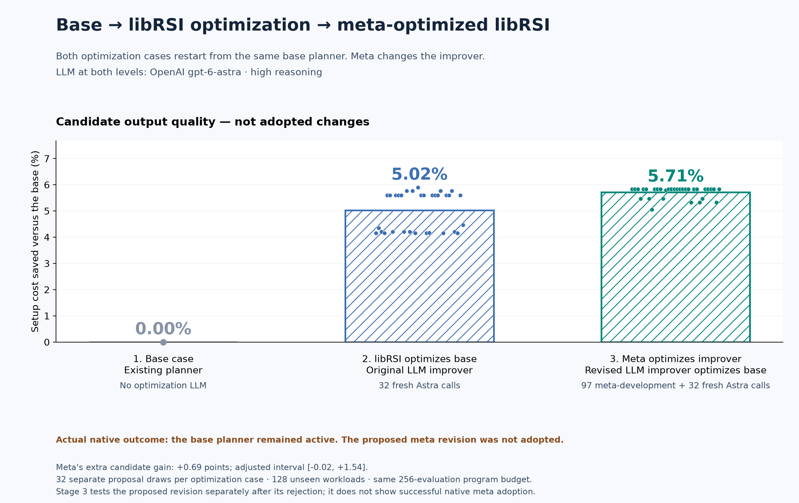
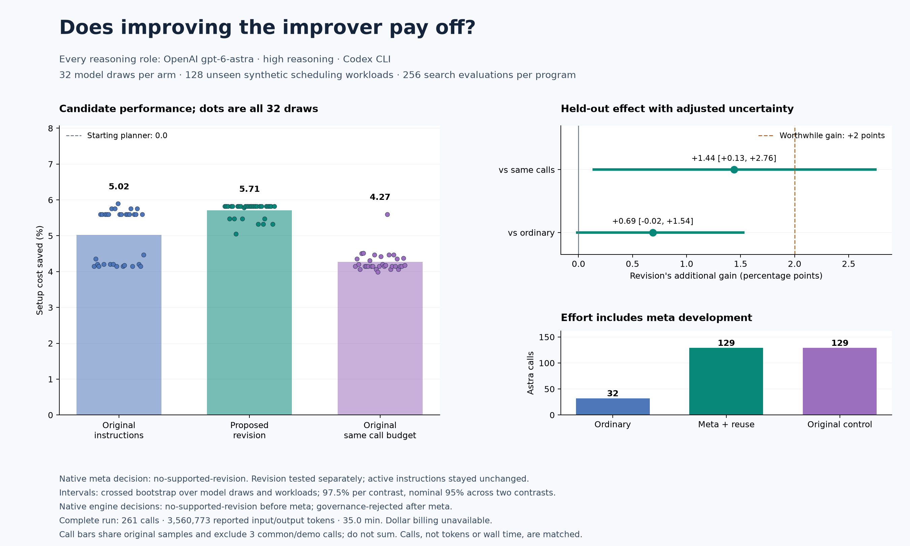

# From a broad goal to measured experiments

This example starts with a caller's goal:

> Reduce downtime from changeovers in our repeating production schedules, while keeping planning inexpensive and covering every job exactly once.

**OpenAI `gpt-6-astra`, high reasoning**, interprets that goal, proposes competing
experiments, designs executable search programs, and later revises the instructions
used to design those programs. The target is a deterministic scheduling algorithm;
it makes **no model calls when planning a schedule**. Review, measurement, exact
reference solving and libRSI decisions also use no model.

This is a synthetic production-sequencing experiment, not measured factory
throughput. The [search diagnosis](meta-diagnosis.md) explains why we changed tasks.

## Measured result

The primary comparison is **base → LLM-driven libRSI optimization of the base →
LLM meta optimization of the improver, followed by its use on the same base**.
Both optimization arms restart from the existing planner. The third arm does not
continue optimizing the second arm's output.



The current data show candidate quality for these three cases. The native passes
kept the base planner and original improver; the revised improver was evaluated
separately after rejection. This is not a successful end-to-end adoption chain.
The figure below retains the secondary equal-call control and uncertainty analysis.



| Frozen proposal policy | Model | Mean setup cost saved | SD across 32 model draws | Model calls |
| --- | --- | ---: | ---: | ---: |
| Original | `gpt-6-astra`, high | 5.02% | 0.73 points | 32 |
| Proposed revision | `gpt-6-astra`, high | 5.71% | 0.21 points | 97 development + 32 reuse |
| Original, same total calls | `gpt-6-astra`, high | 4.27% | 0.28 points | 129 |
| Fixed unbounded local-search reference | None | 7.70% | Not a model sample | 0 |

SD describes model draws on the fixed final workloads; it is not a confidence
interval. The unbounded reference uses more search evaluations and is not an
equal-budget result. There were 8, 5 and 13 distinct selected program strings in
the three model arms, respectively; different strings can still have equivalent
behavior. No sampled program candidate was invalid.

| Registered contrast | Model for both policies | Mean extra gain | Descriptive 95% interval | Adjusted 97.5% interval |
| --- | --- | ---: | --- | --- |
| Revision − ordinary | `gpt-6-astra`, high | +0.69 points | [0.06, 1.40] | [−0.02, 1.54] |
| Revision − same-call original | `gpt-6-astra`, high | +1.44 points | [0.28, 2.59] | [0.13, 2.76] |

The adjusted lower bounds do not exceed the predeclared two-point worthwhile
effect. For ordinary use, the adjusted interval also contains zero and its upper
bound is below two points. Against the same-call control, the interval supports
a positive difference but does not establish a difference of at least two points.
These conclusions are conditional on this frozen revision and workload generator,
not on a population of independent meta training runs.

The same-call original control selected candidates with better tuning scores but
performed worse on final workloads than ordinary sampling. This is consistent
with selection overfitting on the 16-workload tuning set; it does not show that
extra sampling is generally harmful. Keeping this control avoids attributing all
extra search effort to recursive improvement.

| Workload family | Model for all proposal policies | Original | Revision | Same-call original |
| --- | --- | ---: | ---: | ---: |
| Independent costs | `gpt-6-astra`, high | 4.31% | 5.63% | 3.80% |
| Clustered costs | `gpt-6-astra`, high | 2.13% | 2.47% | 1.65% |
| Noisy spatial costs | `gpt-6-astra`, high | 3.48% | 3.46% | 3.20% |
| Sparse cheap transitions | `gpt-6-astra`, high | 10.17% | 11.27% | 8.44% |

Family results are descriptive, not additional confirmatory claims.

The native meta pass returned `no-supported-revision`: development mean cost
reductions were 4.90% for the original policy, 3.90% for the first revision and
4.81% for the second. The second revision was frozen for independent testing,
while the actual active instructions remained original. The ordinary native pass
stopped at investigation; subsequent native use of the reopened active policy
reached comparison but was `governance-rejected` at the forward-shadow stage.
The native planner therefore remained unchanged. Candidate scores above must not
be presented as successful native adoption. The [diagnosis](meta-diagnosis.md)
explains the separate investigation-gate limitation found in these records.

The complete run used **261 model calls**, **3,560,773 reported input/output tokens**
(including 1,447,936 cached input tokens), **35.0 minutes elapsed**, and 157.5 seconds
of Python CPU time. The recorded study executed **3,776 program/workload pairs** and
**950,272 candidate-cost evaluations**, with deterministic repeats cached.
Standalone baseline and reference calculations are outside those counters.

| Effort allocation | Model | Calls | Reported input/output tokens |
| --- | --- | ---: | ---: |
| Ordinary final draws (subset of the original control) | `gpt-6-astra`, high | 32 | 430,055 |
| Meta development plus revised final draws | `gpt-6-astra`, high | 129 | 1,788,312 |
| Original control, same calls | `gpt-6-astra`, high | 129 | 1,733,981 |
| Shared goal interpretation and two native program passes | `gpt-6-astra`, high | 3 | 38,480 |

The first row is included in the third; do not add it to the run total.
The separate exploratory pilots attempted another 32 calls, with 335,601 reported
tokens plus one timeout with unknown final usage. Dollar billing is unavailable.

The [summary](benchmarks/setup-sequence/summary.json),
[all measurements](benchmarks/setup-sequence/report.json.gz),
[prompts and structured model outputs](benchmarks/setup-sequence/model-transcripts.json.gz),
[executed sources](benchmarks/setup-sequence/executed-sources.json.gz),
[validation receipt](benchmarks/setup-sequence/validation.json), and
[SHA-256 manifest](benchmarks/setup-sequence/evidence-manifest.json) make the run
auditable. The no-model replay reconciled every receipt, all 257 sampled selections,
every recorded program execution, all final scores and both bootstrap intervals.
Provider event streams and local stores are retained privately; published model
transcripts contain application prompts and final structured proposals.

## What the model chooses and what the host supplies

The host supplies a measurable environment: 14 jobs, directed setup costs, a
current nearest-neighbor planner, two available metrics, and an execution language.
Every schedule must contain each job exactly once and return to its starting job.
Every proposed search program gets 256 candidate-cost evaluations.

The first Astra call selected **fractional setup-cost reduction** as the primary
metric and **0.02** as the minimum worthwhile absolute effect. Relative to the
starting planner, that means at least 2% less setup cost. For comparisons between
improvers, it means an additional two percentage points of cost reduction.
The no-worthwhile-improvement comparison is `mean_gain <= 0.02`.

Astra proposed two causal explanations: greedy moves aimed at expensive transitions
may be sufficient, or temporary uphill moves and perturbations may escape local
traps before polishing. Its response included newly assembled example programs.
Subsequent proposal calls generate two new programs from the language; the host
does not supply a prewritten inventory of complete candidate programs.

The host validates the model's structured fields and records a native
`OperationalizationRequest`, `OperationalizationProposal`, and accepted evaluation
contract. The agreed objective, metric and minimum effect then configure the
`AdaptiveLoop` policy. This is an explicit mapping: the facade constructs its own
internal contract; it does not consume the identical accepted contract object.

The model's experimental prose is advisory. The host's recorded protocol fixes
sample counts, partitions, selection rules, and analysis. For example, the model
suggested matching the structure of greedy and escape programs; later meta
instructions may change the program strategy. The final comparisons therefore
test **proposal policies**, not an isolated causal effect of annealing or kicks.
The host's two registered contrasts, rather than additional tests suggested in
the prose, define the confirmation analysis.

This distinction matters for integration: libRSI's intent layer can accept a
proposed evaluation contract, while low-level `improve()` requires a completed
operationalization and initial competing hypotheses. Installing libRSI does not
create a general autonomous goal interpreter. The example connects a model to
those interfaces and supplies an executable, measurable host.

## Workload and execution

There are four equally represented workload families: independent costs,
clustered costs, noisy directed spatial costs, and sparse cheap transitions.
All costs are positive integers. The current planner chooses the cheapest
nearest-neighbor cycle across every starting job. An exact Held–Karp solver
provides a reference optimum; the model never sees the optimum route.

A proposed program is JSON with one to six stages. Stages choose move operators
(swap, relocate, reverse), sampling (random, expensive transitions, systematic),
acceptance (improvement, annealing, threshold), temperature, cooling, restarts,
perturbation size and budget allocation. The interpreter keeps the best valid
cycle found. It executes audited primitives, never generated Python or shell.

The 256-evaluation budget includes evaluated perturbations. Randomness is seeded
by workload identity, so replaying the same program on the same workload is
deterministic. Baseline construction, the exact reference and an additional
unbounded local-search reference are outside that budget. The unbounded reference
is a headroom diagnostic, not a budget-matched competitor.

## Exploration, adoption and confirmation

The protocol and source snapshot were saved before the first model call.

| Phase | Model | Work or sampling unit |
| --- | --- | --- |
| Goal interpretation | `gpt-6-astra`, high | One broad-goal interpretation |
| Ordinary native improvement | `gpt-6-astra`, high | Two programs; 16 scoring, 16 shadow, 16 verification workloads |
| Meta development | `gpt-6-astra`, high | 32 original-policy draws, one instruction-revision call, 32 draws for each of two proposed policies |
| Subsequent native use | `gpt-6-astra`, high | A fresh program proposal using the actual reopened active instructions |
| Final confirmation | `gpt-6-astra`, high | 32 revised-policy draws and 129 original-policy draws; 128 held-out workloads |
| Execution, scoring, review | None | Deterministic Python and C++ |

Each program-proposal draw requests two candidates. Selection includes the
unchanged planner and sees only 16 generation workloads. Development uses separate
16-workload scoring, shadow and verification partitions. Final proposals use a
fresh 16-workload selection partition. None of these partitions overlap the 128
final workloads, and model prompts do not contain those final workloads.

The native meta adapter measures whether instructions produce useful programs.
Its observations are 32 independent model-generation draws, each averaged over a
workload partition. libRSI governs instruction adoption using its existing native
policy. Programs within that adapter are selected by a smaller scoring proxy.
Separate ordinary native passes exercise full program adoption and use of the
persisted active policy after reopening the store.

Before final generation, the challenger is frozen: the adopted instructions, or,
if adoption failed, the better of the two proposals by development score. Testing
a rejected challenger allows us to distinguish a weak proposal from an overly
restrictive native decision. Such a challenger is explicitly **not** described
as the active improver.

The three final arms are:

- **Ordinary:** 32 original-improver calls, one independently selected program per call.
- **Revised:** 97 meta-development calls plus 32 fresh calls using the frozen revision.
- **Original, same calls:** 129 original-improver calls, grouped into 32 pools
  (one of five calls, 31 of four); select each pool's program only on final-generation workloads.

The ordinary arm uses the first call from each original-control pool. Those arms
share work; their costs must not be added. Revised and original control both cost
129 model calls. This matches **calls**, not tokens, wall time or dollars. Three
additional shared/demo calls cover goal interpretation and the two native program
passes, making 261 calls for a completed study. Failed data validations spend their
slots and fall back to the baseline; transport failures stop the run without
automatic retries. The hard ceiling is 300 calls.

## What the uncertainty means

Each arm has a 32 × 128 score matrix: **32 model draws and 128 independent workloads**,
not 4,096 independent observations. All selected programs are frozen before final
scoring. No further policy revisions, sample extensions or deeper meta rounds
are triggered by those final scores.

Two contrasts were registered: revised minus ordinary, and revised minus the
original improver with the same call budget. A crossed bootstrap resamples model
draws independently by arm and resamples shared workloads within each family.
We report 95% descriptive percentile intervals and 97.5% intervals for a
Bonferroni adjustment across the two contrasts (nominal family coverage 95%).
These are approximate bootstrap intervals, not exact coverage guarantees.
A worthwhile-effect claim requires the adjusted lower bound to exceed 0.02.
An interval spanning zero is not proof of equivalence.

The native decision remains separate: its one-standard-error bound is not this
confirmation interval. The host's benchmark implements sampling and multiplicity
accounting; libRSI does not automatically infer these experimental requirements.

## Model identity, effort and scope

All reasoning calls use the authenticated public Codex CLI with the explicit
alias `gpt-6-astra` and `model_reasoning_effort="high"`. The CLI exposes an alias,
not an immutable model-weight revision. Tools and network access within the model
session are disabled. Up to six inference requests run concurrently.

The receipt ledger records each role, requested model, reasoning effort, elapsed
time and provider-reported token usage. Wall time includes setup and scoring;
Python CPU time excludes child-process CPU. Program cost evaluations count actual
uncached interpreter executions, not oracle, baseline or diagnostic reference
work. Deterministic execution caching saves host computation; it does not add
independent samples. Subscription credentials do not expose dollar billing; a
missing dollar amount does not mean free execution.

Elapsed time is an observation from a shared VM, including concurrent validation;
it is not a controlled latency comparison between strategies.

Task selection was exploratory. Two eight-call Astra join-order pilots saturated
at the exact optimum. A direct-schedule Astra pilot completed seven of eight
requests, with one timeout. An eight-call Luna calibration produced no improvement
over the starting planner. Luna was discarded; **no main-study role uses Luna**.
All pilot attempts are retained, use separate workloads, and are excluded from
the main study's confirmation evidence and cost totals. This follow-up can test
one newly developed instruction policy, not generalize over independent meta
training runs, other models, factories, task sizes or algorithm languages.

## Run it

From a source checkout, install NumPy and Matplotlib and authenticate the public
Codex CLI with access to Astra. A C++17 compiler is needed for the exact reference.

```bash
python -m pip install . numpy matplotlib
python examples/benchmark_setup_sequence.py --output ./sequence-run --model gpt-6-astra
python examples/plot_setup_sequence.py --report ./sequence-run/report.json --output ./sequence-run/improvement
```

Use a new output directory. The [runner](../examples/benchmark_setup_sequence.py),
[goal interpretation](../examples/sequence_intent.py) and
[program interpreter](../examples/sequence_program.py) show the complete integration.
